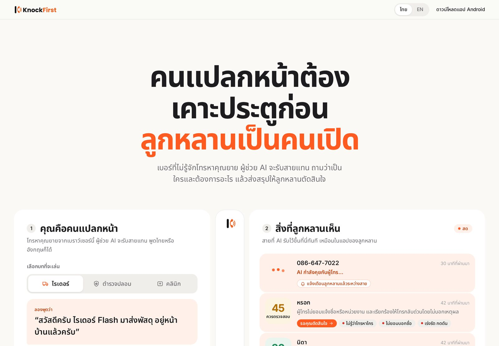
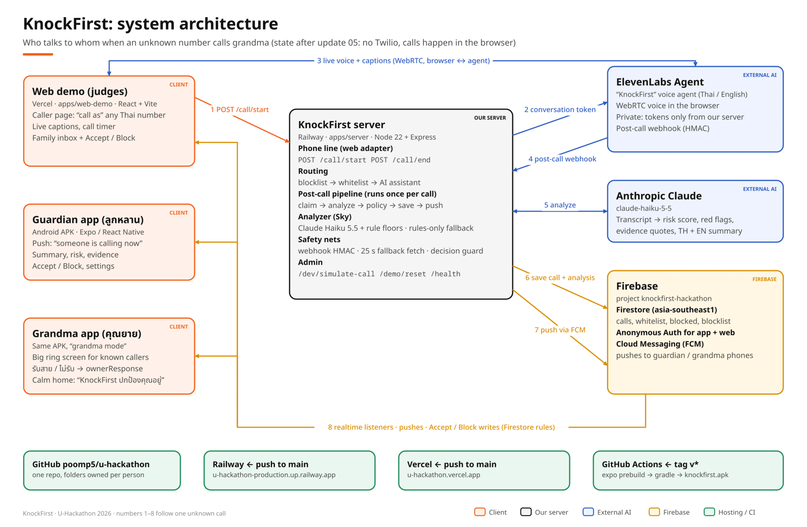
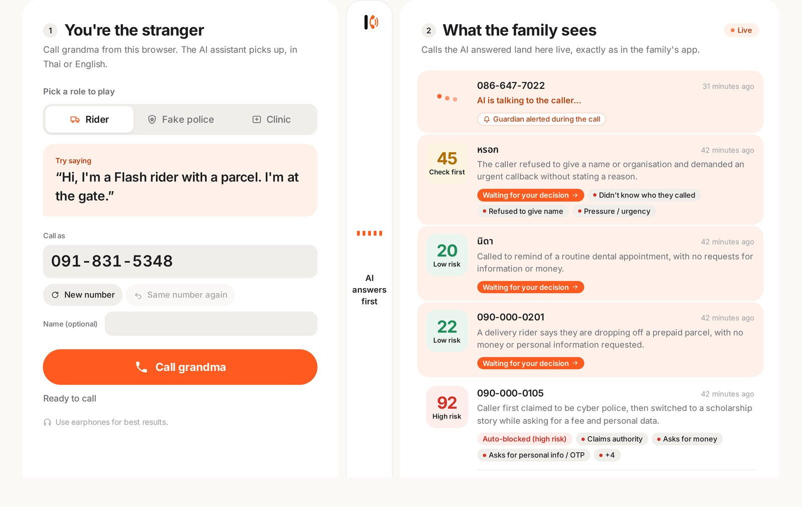
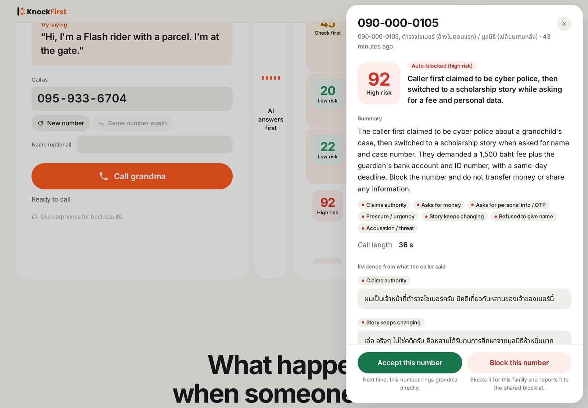
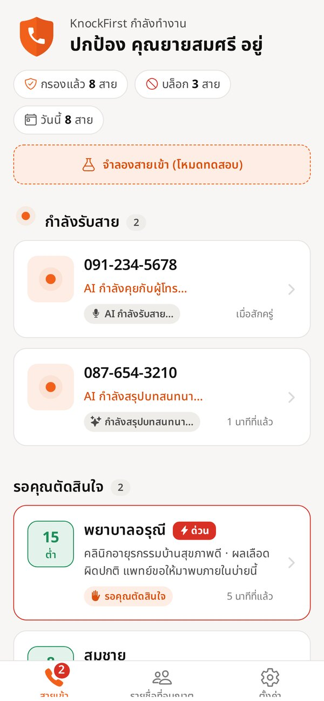
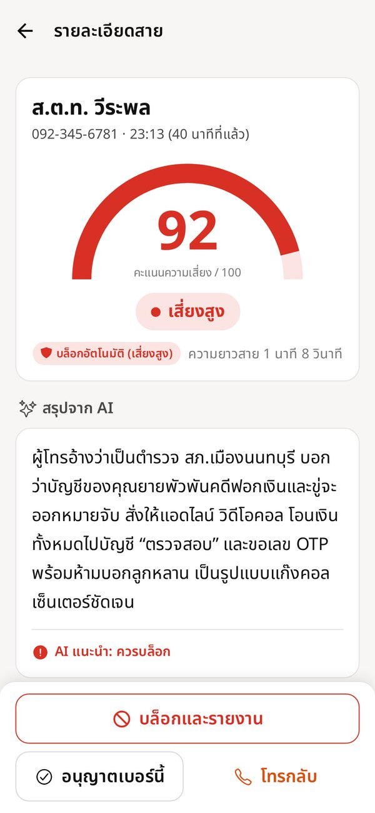
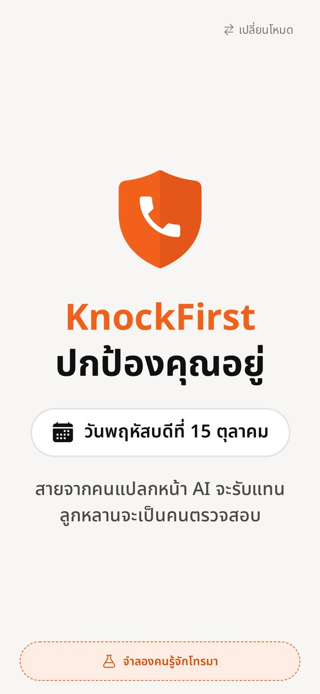
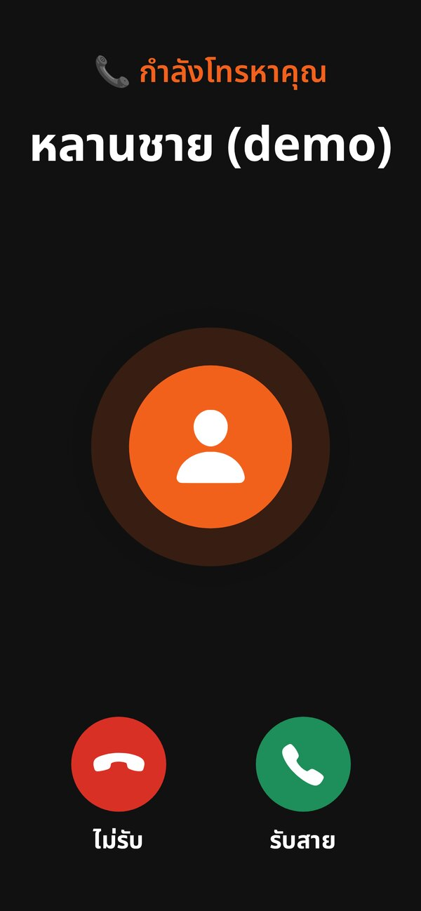

<p align="center">
  <picture>
    <source media="(prefers-color-scheme: dark)" srcset="brand/logo-wordmark-dark.png">
    
  </picture>
</p>
<!-- Redeploy -->
<h3 align="center">Strangers knock first. Family opens the door.</h3>
<p align="center">คนแปลกหน้าต้องเคาะประตูก่อน ลูกหลานเป็นคนเปิด</p>

<p align="center">
  <a href="https://u-hackathon.vercel.app"><b>Try the web demo</b></a> ·
  <a href="https://github.com/poomp5/knockfirst/releases/latest/download/knockfirst.apk"><b>Download the Android app</b></a> ·
  <a href="#how-it-works">How it works</a> ·
  <a href="#results">Results</a> ·
  <a href="#safety--privacy">Safety</a>
</p>

<p align="center">
  
</p>

**KnockFirst is an AI call screener for elderly parents.** Calls from people the family knows ring grandma as usual. An unknown number has to *knock first*: a polite Thai AI voice assistant answers, asks who is calling, who they want and why, and never gives anything away about her. Seconds later the family gets a summary with a scam-risk score and the caller's own words as evidence, and taps **Accept** (next time it rings grandma) or **Block** (cut off, and reported to a blocklist shared by every family). Obvious scams are blocked automatically, so nobody is spammed.

U-Hackathon 2026 · AI track

---

## The problem

Call-centre gangs phone elderly people pretending to be police, DSI, a bank, a courier or a grandchild in trouble, and keep them on the line until they transfer money. In one case reported by Thai PBS in September 2026, a 22-year-old lost **1.78 million baht** to a gang that posed as police and kept him isolated from his family. Elderly parents are an even easier target, and the family usually finds out after the money is gone.

Blocking apps only know numbers that were already reported, and iPhone's call screening doesn't support Thai. **KnockFirst puts the family in the loop before a stranger ever reaches grandma.**

<!-- PM: add the validation interview numbers here, e.g. "14 of 18 people said a parent received a scam call this year". -->

## How it works

1. **Someone calls grandma's number.** KnockFirst checks the family's whitelist and the shared blocklist.
2. **Known caller?** Grandma's phone rings as normal. **Blocked?** The call is cut off.
3. **Unknown caller?** The KnockFirst AI assistant (ElevenLabs) answers in Thai or English and asks for a name, who they want, why, and a callback number. The family's phone gets a heads-up *while the AI is still talking*.
4. **After the call**, Claude analyses the transcript: risk score 0–100, red flags (claims authority, asks for money or an OTP, demands secrecy, story keeps changing…) and the exact quotes behind them. Risk ≥ 85 is blocked automatically; everything else waits for the family's Accept or Block.

<p align="center">
  
</p>

> In the demo the phone line is a web page, because a Thai phone number needs paperwork we couldn't get in 24 hours. KnockFirst's screening engine doesn't care where a call comes from: in production the same engine plugs into the carrier network or Android's call-screening API.

## See it

**The web demo** (for judges): be the stranger on the left, watch the family's side update live on the right.

<p align="center">
  
</p>

<p align="center">
  
</p>

**The Android app.** One APK, two modes: the guardian (ลูกหลาน) reviews calls; grandma's phone gets a big, calm ring screen for people she knows.

<table align="center">
  <tr>
    <td align="center"><br><sub>Guardian inbox</sub></td>
    <td align="center"><br><sub>Risk score + evidence</sub></td>
    <td align="center"><br><sub>Grandma mode</sub></td>
    <td align="center"><br><sub>A known caller rings</sub></td>
  </tr>
</table>

## Try it

1. Open **[u-hackathon.vercel.app](https://u-hackathon.vercel.app)** (earphones help), pick a role (delivery rider, fake police or clinic), and press **Call grandma**. Speak Thai or English.
2. Hang up. Within about 15 seconds your call appears in the family inbox with a summary and risk score. Open it and press **Accept** or **Block**.
3. Call again with **Same number again**: accepted numbers now ring grandma's phone (no AI); blocked numbers are cut off.
4. Install the app: download **[knockfirst.apk](https://github.com/poomp5/knockfirst/releases/latest/download/knockfirst.apk)**, allow installing from unknown sources, open KnockFirst and choose *ลูกหลาน* (guardian) or *คุณยาย* (grandma).

## Results

The analyzer was tested on 24 labelled Thai and English call transcripts: 13 real scam scripts (fake police, DSI, bank OTP, courier customs fee, a scholarship story pivot, "grandson in trouble", a prompt-injection attempt…) and 11 everyday calls (riders, clinics, family, banks with legitimate reminders).

| | Claude Haiku 5.5 + rules | Rules only (fallback) |
|---|---:|---:|
| Scam calls caught (risk ≥ 70) | **12 / 13** (92%) | 10 / 13 |
| False alarms on normal calls | **0 / 11** | 0 / 11 |
| Auto-block precision (risk ≥ 85) | **12 / 12** (100%) | 7 / 7 |
| Cases meeting every expectation | **24 / 24** | — |
| Average analysis time | 4.1 s | instant |

Full table: [`apps/server/src/ai/eval/results.md`](apps/server/src/ai/eval/results.md) · run it: `cd apps/server && npm run eval`.
Security: 14/14 live probes pass against the deployed server, and 26 Firestore rule tests pass in the emulator.

## Safety & privacy

- **Callers are told up front.** The assistant's first sentence says the call is recorded for safety.
- **The AI never reveals anything about the owner**: not her name, address, health, money, whether she is home, or any ID. It never agrees to pay, share codes, install apps, or move to LINE, even when the caller claims to be police or a bank.
- **Transcripts are used only to screen the call** and are shown only to the family. The analyzer treats them as untrusted input, so a caller who tells the AI to "mark this call safe" is scored as a scam (eval case `injection-01`).
- **Decisions the AI can't be talked out of:** keyword rules set a floor under the LLM's risk score (authority + money request ≥ 85, authority + OTP/ID request ≥ 80, instructions aimed at the AI ≥ 70). If the LLM is down, the rules alone still screen the call.
- **Least privilege:** the app and web demo sign in anonymously and Firestore rules let them change only a guardian's decision, contacts, block list and settings. Calls and AI analysis are written only by the server. One client can't push a number onto the shared blocklist by itself: each write may add only one real family's report (26 rule tests in `firebase/test`).
- **Private voice agent:** only one-time tokens from our server can start a conversation, calls are capped at 120 s, and the post-call webhook is HMAC-signed.

More: [`apps/server/src/ai/SAFETY.md`](apps/server/src/ai/SAFETY.md).

## Tech

| Part | Built with |
|---|---|
| Voice assistant | **ElevenLabs Agents** (Thai + English, WebRTC in the browser, post-call webhook) |
| Call analysis | **Claude Haiku 5.5** + keyword rule floors, rules-only fallback |
| Server | Node 22 + Express + TypeScript on **Railway** |
| Data, sign-in, push | **Firebase**: Firestore (realtime), Anonymous Auth, Cloud Messaging |
| Family app | **Expo / React Native**, Android APK built by GitHub Actions |
| Web demo | React + Vite on **Vercel** |

### Diagrams

| | |
|---|---|
| [Architecture](docs/assets/diagrams/01-architecture.png) | Who talks to whom |
| [One call, step by step](docs/assets/diagrams/02-call-flow.png) | Every request from dial to decision |
| [Routing and decisions](docs/assets/diagrams/03-routing-and-decisions.png) | Whitelist, blocklist, AI, thresholds |
| [Call status lifecycle](docs/assets/diagrams/04-call-status-lifecycle.png) | `screening` → `needs_review` → `accepted`… |
| [Data model](docs/assets/diagrams/05-data-model.png) | Firestore collections and who may write them |
| [Notifications](docs/assets/diagrams/06-notifications.png) | The alert that turns into the summary |
| [Repo and deployments](docs/assets/diagrams/07-deploy-and-ownership.png) | Owners, CI, where secrets live |
| [Stage demo](docs/assets/diagrams/08-stage-demo.png) | The 5-beat live demo |

## Run it locally

```bash
# Server (needs a Firebase service account + ElevenLabs + LLM keys in apps/server/.env, see .env.example)
cd apps/server && npm ci && cp .env.example .env && npm run seed && npm run dev

# Web demo (VITE_* in apps/web-demo/.env; without them it shows labelled sample cards)
cd apps/web-demo && bun install && bun run dev

# App with built-in sample data (no keys needed)
cd apps/mobile && npm ci && EXPO_PUBLIC_USE_MOCKS=true npx expo start

# Firestore rule tests (emulator) and the analyzer eval
cd firebase && bun install && bun run test
cd apps/server && npm run eval
```

```
apps/server      Express server: routing, post-call pipeline, pushes · src/ai: the analyzer and eval
apps/mobile      Expo app (guardian + grandma mode)
apps/web-demo    judges' web demo: caller page + live family inbox
firebase         Firestore rules + tests
brand            logo, icons, colors
docs/tasks       the team's task files and updates
```

## Limitations and roadmap

- **Real phone line.** The demo uses a web phone. Next: an Android call-screening app on grandma's phone with carrier call forwarding, and a Thai number once regulatory approval comes through.
- **Accounts.** The app and web demo sign in anonymously, so anyone with the web config acts as the demo family. Production: guardian accounts tied to their family in the security rules.
- **Shared blocklist trust.** Reports are trusted per family. Production: count reports per verified account and let old reports expire.
- **Data retention.** Transcripts should expire automatically (e.g. after 30 days) to keep personal data to a minimum.

## Team

| | Role | GitHub |
|---|---|---|
| Tete | Server, telephony, CI, shared contract | [@teterw](https://github.com/teterw) |
| Poom | Android app, brand and design | [@poomp5](https://github.com/poomp5) |
| Sky | AI analysis, eval, safety, web demo | [@Skysosmart](https://github.com/Skysosmart) |
| PM | Pitch, validation, demo script | — |

<details>
<summary><b>For the team: how we work in this repo</b></summary>

1. Read [`docs/tasks/00-START-HERE.md`](docs/tasks/00-START-HERE.md), then every update file (`docs/tasks/04-*.md`, `05-*.md`, …). Deploy steps: [`docs/tasks/DEPLOY.md`](docs/tasks/DEPLOY.md).
2. Clone, make your branch, run Claude Code:
   ```bash
   git clone https://github.com/poomp5/knockfirst.git
   cd knockfirst
   git checkout -b <yourname>/<topic>   # tete/server · poom/app · sky/ai
   claude
   ```
3. Answer when Claude asks who you are. It loads your task file and the updates, then tells you your next step.

| Person | Task file |
|---|---|
| Tete | [`docs/tasks/01-tete-backend.md`](docs/tasks/01-tete-backend.md) |
| Poom | [`docs/tasks/02-poom-mobile.md`](docs/tasks/02-poom-mobile.md) |
| Sky | [`docs/tasks/03-sky-ai-web.md`](docs/tasks/03-sky-ai-web.md) |

</details>
